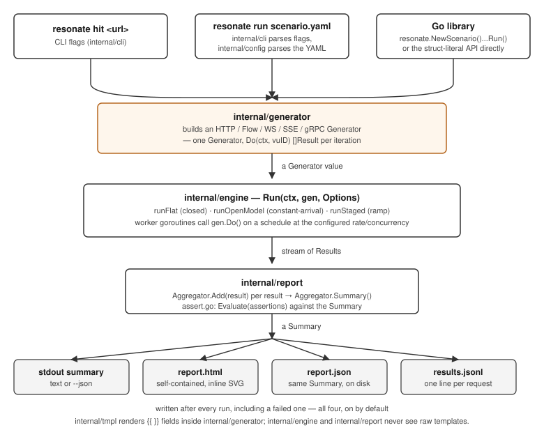

# Architecture

A map of the codebase for anyone extending resonate: how a run flows through it,
what each package and file is for, the rules that cut across protocols, and what to
touch to add a new one.

## Request flow

Three entry points (`resonate hit`, `resonate run`, the Go library) all build a
`generator.Generator`, which `engine.Run` drives at the configured concurrency and
rate, streaming `generator.Result`s into a `report.Aggregator`. The resulting
`report.Summary` is printed and written to the four report formats (see
[Reports](reports.md)).



The `Generator` interface is deliberately small and protocol-agnostic:

```go
type Generator interface {
	Do(ctx context.Context, vuID int) []Result // one iteration
	Protocol() string
	Close() error
}
```

One call to `Do` is one *iteration* for one virtual user, and returns a `Result` per
request-like thing that happened in it. What an iteration and a `Result` are is the one
thing that differs between protocols (see below). The engine never needs to know.

## Protocols and entry points

| Protocol | Generator | Scenario section | `resonate hit` | Library | Guide |
| --- | --- | --- | --- | --- | --- |
| HTTP (1.1, and 2 via `h2c`) | `HTTPGenerator`, `FlowGenerator` | `http` | yes | struct API and `Scenario` builder | [Usage](usage.md), [Scenarios](scenarios.md) |
| HTTP/3 | the same two, with `HTTPOptions.HTTP3` | `http.http3`, `sse.http3` | yes (`--http3`) | struct API and `Scenario.HTTP3()` | [HTTP/3](http3.md) |
| WebSocket | `WSGenerator` | `ws` | no | struct API and `Scenario` builder | [Scenarios](scenarios.md#websocket) |
| Server-Sent Events | `SSEGenerator` | `sse` | no | struct API | [SSE](sse.md) |
| gRPC (unary and streaming) | `GRPCGenerator` | `grpc` | no | struct API | [gRPC](grpc.md) |

What an iteration produces:

| Protocol | An iteration is | `Result`s |
| --- | --- | --- |
| HTTP | one request (`targets`) or one pass over a `flow` | one per request |
| WebSocket | one connection's message sequence | the connect, then one per message |
| SSE | one stream | the connect, then one per event |
| gRPC | one `calls` sequence | one per unary call; one per *received* message of a streaming call |

## Packages

- **root package (`resonate`)** — the public, embeddable API. `generator.go`,
  `engine.go` and `report.go` are thin: type aliases plus one-line wrapper functions
  over the internal packages, so values stay interchangeable with code that imports
  those directly. Adding an exported type internally does **not** make it public; it has
  to be added here, deliberately. `dsl.go`'s `Scenario` is the exception — a fluent builder
  with its own state (the current request or message, a control-flow block stack) layered
  on top, covering HTTP targets and flows, WebSocket, and HTTP/3 (`HTTP3()`). SSE and gRPC
  are used through their struct APIs. See [Library](library.md).
- **`internal/generator`** — the `Generator` interface and its implementations:
  - `http.go` — `HTTPGenerator` and the machinery shared by every HTTP-based
    generator: `compileHTTPFields`, `buildRequest`, `doHTTP`, `newHTTPClient`
    (HTTP/1.1, `h2c`, or HTTP/3 transports), `newTLSConfig`, `closeClient`, and the
    construction-time URL checks.
  - `flow.go` — `FlowGenerator`: ordered steps with response chaining, per-VU `setup`,
    identities, and `repeat`/`during`/`if` control flow.
  - `ws.go` — `WSGenerator`.
  - `sse.go` — `SSEGenerator`, built on the same request-building code as HTTP.
  - `grpc.go`, `grpc_stream.go`, `grpc_schema.go` — `GRPCGenerator`: unary calls,
    streaming calls, and schema resolution from reflection, `.proto` files or a
    descriptor set.
  - `extract.go` — the extraction / `expect_body` rule language (`json:`, `yaml:`,
    `xml:`, `regex:`, `css:`, `header:`, `status`), shared by every protocol.
  - `feeder.go`, `kafka_feeder.go` — data feeders: CSV/JSON files (in-memory, random, or
    streamed) and Kafka topics.
- **`internal/tmpl`** — per-request templating (`{{ }}`) for URLs, query params,
  headers and bodies. See [Request Templating](usage.md#request-templating).
- **`internal/engine`** — the worker pool and rate limiter that drive a `Generator`
  (flat closed model, open model, or a staged ramp), and each virtual user's lifetime
  (`load.iterations`). See [Execution Models](execution-models.md).
- **`internal/report`** — `report.go` aggregates results into latency percentiles
  (an HDR histogram, so memory is fixed), success rate, throughput and status/error
  breakdowns; `assert.go` evaluates `assertions:` against a finished `Summary`;
  `html.go` renders the self-contained HTML report (its charts are server-side SVG
  and CSS, with no JavaScript).
- **`internal/config`** — the YAML scenario schema and loader, and the embedded JSON
  Schema (`scenario.schema.json`, printed by `resonate schema`).
- **`internal/cli`** — the Cobra commands. `hit.go` and `run.go` build a generator and
  engine options, then call `runAndReport` in `common.go`, which owns progress output,
  the reports, assertions and the exit code.
- **`cmd/resonate`** is the binary; **`cmd/gendocs`** regenerates the
  [CLI Reference](cli/resonate.md) from the cobra command tree.

## Rules that cut across protocols

These are decisions that look arbitrary until you hit the bug they prevent, so they
hold for every protocol. [`CLAUDE.md`](https://github.com/jecklgamis/resonate/blob/main/CLAUDE.md)
has the full rationale for each.

- **Fail fast, before any request is sent,** when a bad config would otherwise degrade
  silently or become an unthrottled busy loop. A request that fails with no network I/O
  returns instantly, so a worker with no `rate` set would spin at millions of iterations
  a second. That is why literal URLs are validated at construction, why HTTP/3 rejects a
  non-`https://` URL up front, and why gRPC calls wait for a connection (*wait-for-ready*)
  instead of failing the instant a server is down. See [Usage](usage.md#validation).
- **Bound anything that can last forever.** A stream with no `events`, `duration` or
  `receive` that is still open at `timeout` is a *failure*, not a hang, so an endless
  stream can't pin a worker for the whole run.
- **A call or stream cut off by the run's own end is never reported as a failure.**
  `runEnded(ctx)` checks the context *and* its deadline against the clock, because gRPC
  fails a call the instant its deadline passes, a few microseconds before the context
  marks itself done. (Plain HTTP requests still report a few end-of-run
  `context deadline exceeded` errors; that is existing behavior.)
- **Streams are reported by their parts.** WebSocket, SSE and gRPC streaming give a
  `Result` per message or event, with the latency being the gap since the previous one,
  so the report's request count and rate mean messages, not iterations.
- **HTTP/3 is opt-in, with no fallback.** A silent fall back to TCP would make an HTTP/3
  run measure HTTP/1.1, so the tests assert what the *server* observed.
- **One source of truth per topic.** Each protocol with real depth has one guide page
  (`grpc.md`, `sse.md`, `http3.md`); `scenarios.md` points to it rather than repeating it.

## Adding a protocol

The engine, reports and assertions need no changes; everything else follows the same
shape. Use `ws.go` or `sse.go` (both small) as a template, and `grpc.go` for a protocol
with a schema.

1. **Generator** in `internal/generator/<proto>.go`: validate everything you can at
   construction; decide what an iteration and a `Result` are; make `Do` safe for
   concurrent use; drop work cut off by `runEnded`; make `Close` release everything.
2. **Facade** in the root `generator.go`: type aliases and a constructor.
3. **Config** in `internal/config/config.go`: a section struct and a `Scenario` field;
   add the protocol to the `allOf` chain and a `$defs` entry in
   `scenario.schema.json`.
4. **CLI** in `internal/cli/run.go`: a case in `buildGenerator`, a builder function,
   and the protocol name in the unsupported-protocol error.
5. **Tests**: the generator (against an in-process server, with `-race`), the CLI
   end to end, config parsing, and the public API in `resonate_test.go`.
6. **Docs**: a guide page in `docs/`, the sidebar, links from the overview, usage,
   reports, library and this page, and `CLAUDE.md`. Regenerate `docs/cli` if the CLI
   changed (`make docs`).
7. **Example and example server** if the protocol needs a target a user can't easily
   have (see below), so the guide's scenarios can be run and, in tests, are.

## Examples and example servers

`examples/` holds runnable scenarios, and a demo server for each protocol that is hard
to find a target for. Each server logs like an access log (a `call` line as a request
arrives, a `done` line when it finishes) and has a `-log-requests=false` mode that
prints a periodic summary instead, for load tests.

| Server | Make target | Default port | Serves | Guide |
| --- | --- | --- | --- | --- |
| `examples/testgrpcserver` | `make example-grpc-server` | `:50051` | `acme.user.v1.UserService` (unary) and `acme.feed.v1.Feed` (all streaming kinds), from `examples/proto` | [gRPC](grpc.md#the-example-server) |
| `examples/testsseserver` | `make example-sse-server` | `:8765` | finite, endless, POST-streaming, wrong-content-type and error endpoints | [SSE](sse.md#the-example-server) |
| `examples/testhttp3server` | `make example-http3-server` | `:8443` (UDP and TCP) | `/proto` reports the protocol version, plus echo and SSE, over HTTP/3 *and* TCP | [HTTP/3](http3.md#the-example-server) |

Pass flags with `ARGS`, e.g. `make example-sse-server ARGS=-log-requests=false`. 50051
and 8443 are the conventional gRPC and alternate-HTTPS ports; the SSE server avoids
8080, which is commonly already taken on a development machine, and each takes `-addr`
if a port is busy. `examples/dsl-examples` is a separate Go module showing the fluent
builder.

## How it is tested

- **Unit and integration tests** sit beside the code. `internal/generator` runs against
  in-process servers (`httptest`, an `http3.Server`, an in-process gRPC server);
  `internal/engine` against a fake generator; `internal/cli` end to end by capturing the
  real stdout. Run `go test ./... -race`: the engine and generators use goroutines,
  atomics and `sync.Map`.
- **The shipped examples and the docs are tested.** Each example server's tests run the
  real example scenarios, and every complete scenario in the guides, through the real
  `resonate run` command against that server, with only the host rewritten. A scenario is
  strict-parsed first, so a misspelled key (which resonate itself would ignore) fails. A
  block preceded by `<!-- docs-test: parse-only -->` is parsed but not run. If you change a
  scenario in a guide, these tests tell you whether it still works.
- **The JSON Schema** has no automated test of its own. When you change it, check it
  against every example and documented scenario with a JSON Schema validator (draft
  2020-12), and check that the protocol/section rules reject the mismatches they should.
- **`make check`** runs `gofmt`, `go vet` and the tests; **`make docs-check`** fails if
  `docs/cli` has drifted from the code. CI runs both on every push.

For the deeper design rationale (why `runStaged` doesn't use
`rate.Limiter.SetLimitAt`, the validation philosophy, per-package testing patterns), see
[`CLAUDE.md`](https://github.com/jecklgamis/resonate/blob/main/CLAUDE.md) in the repo.
